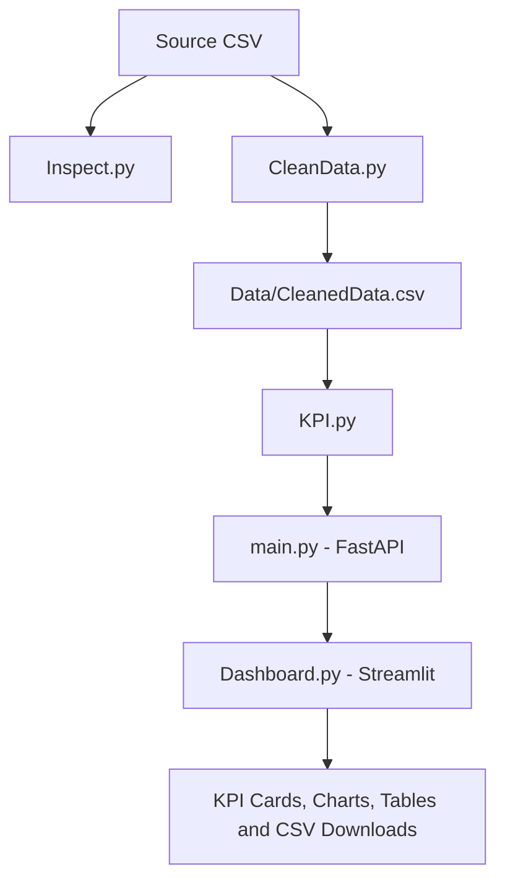

# Call Center Analytics

A Python-based call center analytics application that cleans call records, calculates operational KPIs, exposes the results through a REST API, and presents them in an interactive Streamlit dashboard.

The project consists of separate modules for data inspection, ETL processing, KPI calculation, API development, dashboard presentation, and automated data validation.

## Project Overview

The application uses CSV data as its input. The ETL module prepares the dataset, the KPI module calculates performance metrics, and the FastAPI application makes those metrics available through HTTP endpoints. The Streamlit dashboard consumes the API and displays the results in tables and interactive charts.

The application supports overall KPI calculations, aggregation by team and shift, daily KPI aggregation, and filtering by team, shift, and date range.

## Key Features

- **Data inspection:** Reports dataset dimensions, column information, missing values, categorical distributions, and selected data-quality issues.
- **ETL processing:** Normalizes customer phone values, removes duplicate call IDs, and handles missing values in selected fields.
- **KPI calculation:** Calculates Answer Rate, Abandon Rate, Average Waiting Time, Average Handling Time, CSAT, and FCR.
- **REST API:** Provides endpoints for an overall KPI summary, team-level KPIs, shift-level KPIs, and daily KPIs.
- **Interactive dashboard:** Displays KPI cards, charts, detailed tables, and CSV downloads.
- **Filtering:** Supports team, shift, start-date, and end-date filters through the API.
- **Persian interface:** Supports right-to-left layout, Persian labels and digits, and Jalali/Gregorian date display.
- **Automated tests:** Includes pytest tests for dataset structure and selected data-quality requirements.

## Architecture and Data Flow



### Processing Workflow

1. `Inspect.py` loads and inspects the source dataset.
2. `CleanData.py` applies the implemented ETL transformations and writes `Data/CleanedData.csv`.
3. `KPI.py` loads the cleaned dataset, prepares dates and shifts, calculates KPIs, and performs aggregations.
4. `main.py` exposes the KPI calculations through FastAPI endpoints.
5. `Dashboard.py` sends requests to the API and displays the returned data.
6. The pytest tests validate selected properties of the cleaned dataset.

The API delegates KPI calculations to `KPI.py`. The dashboard consumes the API responses rather than implementing a separate set of KPI formulas.

## Project Structure

```text
Call Center/
├── Data/
│   ├── call_center_1000_with_reason_phone.csv
│   └── CleanedData.csv
├── Inspect.py
├── CleanData.py
├── KPI.py
├── main.py
├── Dashboard.py
├── Recomendation.md
├── requirements.txt
└── README.md
```

### Main Components

| File or Directory | Description |
|---|---|
| `Data/` | Contains the source CSV and the generated cleaned dataset. |
| `call_center_1000_with_reason_phone.csv` | Source call-level dataset. |
| `CleanedData.csv` | ETL output consumed by the KPI module. |
| `Inspect.py` | Reports dataset characteristics and selected data-quality issues. |
| `CleanData.py` | Normalizes phone values, removes duplicate call IDs, handles selected missing values, and saves the cleaned CSV. |
| `KPI.py` | Prepares dates and shifts, calculates KPIs, filters data, and performs aggregations. |
| `main.py` | Defines the FastAPI application and its endpoints. |
| `Dashboard.py` | Implements the interactive Streamlit dashboard. |
| `Recomendation.md` | Separate project document; its contents are outside the scope of this technical README. |
| `requirements.txt` | Lists the project's Python dependencies. |
| `README.md` | Documents the technical structure and usage of the application. |

## Technology Stack

| Technology | Purpose |
|---|---|
| Python | Main programming language |
| Pandas | CSV loading, data transformation, filtering, and aggregation |
| FastAPI | REST API development |
| Uvicorn | ASGI server for running FastAPI |
| Streamlit | Interactive dashboard |
| Plotly | Interactive charts |
| Requests | HTTP requests from the dashboard to the API |
| Tabulate | Formatted console tables in the inspection module |
| Pytest | Automated testing |
| HTTPX | HTTP client dependency available for testing and API-related tasks |
| Pydantic | Data validation support in the API stack |

The code also uses Python standard-library modules, including `pathlib`, `re`, `json`, `datetime`, `html`, `inspect`, and `math`.

## Dataset

The source dataset is located at:

```text
Data/call_center_1000_with_reason_phone.csv
```

The ETL process generates the cleaned dataset at:

```text
Data/CleanedData.csv
```

Each row represents a call record.

### Data Dictionary

| Column | Description |
|---|---|
| `call_id` | Identifier of a call |
| `call_date` | Date on which the call occurred |
| `start_time` | Call start time |
| `customer_phone` | Customer phone number |
| `call_reason` | Reason for the call |
| `agent_id` | Identifier of the associated agent |
| `queue` | Team or queue associated with the call |
| `channel` | Communication channel |
| `status` | Call status |
| `wait_seconds` | Waiting time in seconds |
| `handle_seconds` | Call handling duration in seconds |
| `hold_seconds` | Time spent on hold in seconds |
| `after_call_work_seconds` | Time spent on post-call work in seconds |
| `csat_score` | Customer satisfaction score |
| `first_contact_resolution` | Indicates whether the issue was resolved during the first contact |
| `transfer_count` | Number of transfers recorded for the call |

The KPI module treats `Answered` and `Transferred` calls as handled calls. The dashboard's team filter provides `Billing`, `Sales`, and `Support` as its team options.

## Data Inspection

`Inspect.py` loads the source CSV and preserves `customer_phone` as a string.

The inspection functions provide:

- Dataset dimensions, column names, data types, missing-value counts, and column descriptions
- Counts of status values
- Counts of communication channels
- Counts of call reasons
- Counts of queues
- Distinct agent IDs associated with each queue
- Detection of invalid start times
- Detection of negative values in selected numeric columns
- Detection of invalid date formats and calendar dates
- Detection of phone prefixes and multiple phone numbers in a cell
- Detection of missing values in duration columns
- Detection of duplicate call IDs

### Date and Time Checks

The date validation expects `M/D/YYYY` or `MM/DD/YYYY` and checks whether each value represents a valid calendar date.

The time validation accepts `H:MM:SS` or `HH:MM:SS`, using 24-hour time rules.

These functions report problems in the source dataset; they do not clean or modify the source records.

### Running Data Inspection

From the project root:

```powershell
python Inspect.py
```

## ETL and Data Cleaning

`CleanData.py` reads the source dataset and writes the transformed records to `Data/CleanedData.csv`.

### Customer Phone Normalization

The phone-cleaning functions:

1. Split a cell into phone values when common delimiters are present, including commas, semicolons, pipes, Arabic commas, and line breaks.
2. Keep the first non-empty phone number in each cell.
3. Remove non-digit characters, including spaces and plus signs.
4. Remove a leading country prefix `98` or local prefix `0`, when present.
5. Return a missing value if no usable digit sequence remains.

The ETL does not validate phone-number length and does not append a country prefix. When a cell contains multiple phone numbers, the additional numbers are not retained in the cleaned value. The script reports the number of rows that contained multiple phone values.

### Duplicate Call IDs

Duplicate records are removed based on `call_id`. The first occurrence is retained; subsequent rows with the same call ID are removed.

### Duration Columns

The following columns are converted to numeric values, and missing values are replaced with zero:

- `wait_seconds`
- `hold_seconds`
- `handle_seconds`
- `after_call_work_seconds`

Conversion errors raise an exception.

Negative values in `hold_seconds` are converted to their absolute values. The ETL does not apply the same transformation to every other numeric column.

### Other Missing Values

The current implementation applies these transformations:

| Column | Implemented behavior |
|---|---|
| `csat_score` | Converts values to numeric and fills missing values with `0`. |
| `first_contact_resolution` | Fills missing values with `"No"`. |
| `agent_id` | Converts values to strings and fills missing values with `"A01"`. |
| `customer_phone` | Missing or unusable values remain missing. |

The ETL does not automatically correct invalid call dates or start times.

### Output Safety Check

Before saving, the script checks that a non-empty source dataset has not unexpectedly produced an empty cleaned dataset. It creates the output directory if necessary and writes the resulting DataFrame to `Data/CleanedData.csv`.

### Running ETL

```powershell
python CleanData.py
```

## KPI Calculation

`KPI.py` loads `Data/CleanedData.csv`, prepares the date and time fields, applies optional filters, and calculates KPIs.

### Date Preparation

The module parses `call_date` using the `%m/%d/%Y` format. Invalid dates are converted to missing datetime values during preparation.

### Shift Classification

The hour extracted from `start_time` determines the shift.

| Shift | Time Range |
|---|---|
| `Morning` | 06:00–13:59 |
| `Evening` | 14:00–21:59 |
| `Night` | 22:00–05:59, across midnight |
| `Unknown` | Invalid or missing start times |

The implemented hour boundaries are:

- Morning: `6 <= hour < 14`
- Evening: `14 <= hour < 22`
- Night: `hour >= 22` or `hour < 6`

If a start time does not match the expected time pattern, its shift is set to `Unknown`.

### Answer Rate

The code treats `Answered` and `Transferred` calls as handled calls.

\[
\text{Answer Rate} =
\frac{\text{Handled Calls}}{\text{Total Calls}}\times100
\]

### Abandon Rate

\[
\text{Abandon Rate} =
\frac{\text{Abandoned Calls}}{\text{Total Calls}}\times100
\]

### Average Waiting Time (AWT)

AWT is the mean of `wait_seconds` for calls whose status is `Answered` or `Transferred`.

### Average Handling Time (AHT)

For each handled call, the code sums these duration fields:

- `handle_seconds`
- `hold_seconds`
- `after_call_work_seconds`

AHT is the mean of the summed duration. The implementation requires all three components to be numeric for a call's summed value to be valid.

### Customer Satisfaction (CSAT)

The average CSAT score is calculated only for calls that:

- Have status `Answered` or `Transferred`
- Have a `csat_score` greater than zero

Abandoned calls and zero scores are excluded from the average.

### First Contact Resolution (FCR)

The code normalizes supported true values, including `Yes`, `Y`, `True`, `1`, and `1.0`, to `True`. It normalizes `No`, `N`, `False`, `0`, and `0.0` to `False`. Other values are treated as unrecognized.

FCR eligibility requires a handled call and a recognized true/false value in `first_contact_resolution`.

\[
\text{FCR} =
\frac{\text{Eligible Calls Resolved at First Contact}}{\text{Eligible Handled Calls}}\times100
\]

### KPI Output Fields

The calculation returns these fields:

| Field | Description |
|---|---|
| `total_calls` | Total rows in the filtered dataset |
| `answered_calls` | Number of calls with status `Answered` |
| `abandoned_calls` | Number of calls with status `Abandoned` |
| `transferred_calls` | Number of calls with status `Transferred` |
| `handled_calls` | Number of `Answered` and `Transferred` calls |
| `answer_rate_pct` | Answer Rate as a percentage |
| `abandon_rate_pct` | Abandon Rate as a percentage |
| `average_wait_time_seconds` | Average eligible waiting time |
| `average_handle_time_seconds` | Average eligible summed handling duration |
| `average_csat_score` | Average eligible CSAT score |
| `fcr_eligible_calls` | Number of calls eligible for FCR |
| `fcr_resolved_calls` | Number of eligible calls resolved at first contact |
| `fcr_rate_pct` | FCR as a percentage |

When a metric has no numeric values or its denominator is zero, the KPI helper functions return `None`. The API represents these values as JSON `null`.

### Available KPI Functions

`KPI.py` provides:

- `calculate_kpis()` — calculates overall KPIs for a DataFrame
- `calculate_kpis_by_team()` — calculates KPIs grouped by queue, exposed as `team`
- `calculate_kpis_by_shift()` — calculates KPIs grouped by shift
- `calculate_daily_kpis()` — calculates KPIs grouped by calendar date
- `filter_data()` — filters calls by team, shift, and date range
- `prepare_data()` — parses dates and derives the shift field
- `load_cleaned_data()` — loads the cleaned CSV

### Filtering Rules

The team filter compares the supplied value against `queue` without case sensitivity.

The shift filter accepts `Morning`, `Evening`, `Night`, or `Unknown`, without case sensitivity. An unsupported shift raises a `ValueError`.

The `start_date` and `end_date` filters use inclusive boundaries. If both dates are supplied and the start date is later than the end date, the function raises a `ValueError`.

### Running KPI Calculations Directly

```powershell
python KPI.py
```

The script prints the overall KPI summary, KPIs by team, KPIs by shift, and daily KPIs.

## REST API

The FastAPI application is defined in `main.py`.

**Application title:** `Call Center Analytics API`

**Description:** `API for Call Center performance KPIs`

**Version:** `1.0.0`

### Base URL

When running locally with the default configuration:

```text
http://127.0.0.1:8000
```

All application endpoints documented below use the `GET` method.

### Endpoint Reference

| Method | Endpoint | Purpose | Supported Query Parameters |
|---|---|---|---|
| `GET` | `/` | Returns the API message and documentation path | None |
| `GET` | `/api/kpis/summary` | Returns KPIs for the filtered records | `team`, `shift`, `start_date`, `end_date` |
| `GET` | `/api/kpis/teams` | Returns KPI data grouped by team | `shift`, `start_date`, `end_date` |
| `GET` | `/api/kpis/shifts` | Returns KPI data grouped by shift | `team`, `start_date`, `end_date` |
| `GET` | `/api/kpis/daily` | Returns KPI data grouped by date | `team`, `shift`, `start_date`, `end_date` |

### Query Parameters

All supported filters are optional.

| Parameter | Type | Description | Example |
|---|---|---|---|
| `team` | String | Filters the `queue` field | `Support` |
| `shift` | String | Filters the derived shift | `Evening` |
| `start_date` | Date | Inclusive start date | `2026-01-01` |
| `end_date` | Date | Inclusive end date | `2026-01-29` |

Dates must be valid values in `YYYY-MM-DD` format.

The team endpoint intentionally does not accept a `team` filter because it returns a comparison across teams. The shift endpoint intentionally does not accept a `shift` filter because it returns a comparison across shifts.

An unsupported team name is not rejected against a predefined enumeration. It may return an empty result because it does not match any `queue` value.

An unsupported shift raises a filtering error.

### 1. Root Endpoint

**Request**

```http
GET /
```

**Response**

```json
{
  "message": "Call Center Analytics API",
  "docs": "/docs"
}
```

### 2. KPI Summary

**Request**

```http
GET /api/kpis/summary
```

Example with filters:

```http
GET /api/kpis/summary?team=Support&shift=Evening&start_date=2026-01-01&end_date=2026-01-29
```

**Response structure**

```json
{
  "filters": {
    "team": "Support",
    "shift": "Evening",
    "start_date": "2026-01-01",
    "end_date": "2026-01-29"
  },
  "kpis": {
    "total_calls": 0,
    "answered_calls": 0,
    "abandoned_calls": 0,
    "transferred_calls": 0,
    "handled_calls": 0,
    "answer_rate_pct": 0.0,
    "abandon_rate_pct": 0.0,
    "average_wait_time_seconds": 0.0,
    "average_handle_time_seconds": 0.0,
    "average_csat_score": 0.0,
    "fcr_eligible_calls": 0,
    "fcr_resolved_calls": 0,
    "fcr_rate_pct": 0.0
  }
}
```

The numbers are placeholders that illustrate the response fields, not real calculated results. Each filter is returned in `filters`; omitted filters are represented by `null`.

### 3. Team KPIs

**Request**

```http
GET /api/kpis/teams
```

Example:

```http
GET /api/kpis/teams?shift=Evening&start_date=2026-01-01&end_date=2026-01-29
```

**Response structure**

```json
{
  "filters": {
    "team": null,
    "shift": "Evening",
    "start_date": "2026-01-01",
    "end_date": "2026-01-29"
  },
  "count": 1,
  "data": [
    {
      "team": "Support",
      "total_calls": 0,
      "answered_calls": 0,
      "abandoned_calls": 0,
      "transferred_calls": 0,
      "handled_calls": 0,
      "answer_rate_pct": 0.0,
      "abandon_rate_pct": 0.0,
      "average_wait_time_seconds": 0.0,
      "average_handle_time_seconds": 0.0,
      "average_csat_score": 0.0,
      "fcr_eligible_calls": 0,
      "fcr_resolved_calls": 0,
      "fcr_rate_pct": 0.0
    }
  ]
}
```

`count` is the number of records returned in `data`. Each record represents one team in the filtered dataset.

### 4. Shift KPIs

**Request**

```http
GET /api/kpis/shifts
```

Example:

```http
GET /api/kpis/shifts?team=Sales&start_date=2026-01-01&end_date=2026-01-29
```

**Response structure**

```json
{
  "filters": {
    "team": "Sales",
    "shift": null,
    "start_date": "2026-01-01",
    "end_date": "2026-01-29"
  },
  "count": 1,
  "data": [
    {
      "shift": "Morning",
      "total_calls": 0,
      "answered_calls": 0,
      "abandoned_calls": 0,
      "transferred_calls": 0,
      "handled_calls": 0,
      "answer_rate_pct": 0.0,
      "abandon_rate_pct": 0.0,
      "average_wait_time_seconds": 0.0,
      "average_handle_time_seconds": 0.0,
      "average_csat_score": 0.0,
      "fcr_eligible_calls": 0,
      "fcr_resolved_calls": 0,
      "fcr_rate_pct": 0.0
    }
  ]
}
```

Each record in `data` represents one shift in the filtered dataset.

### 5. Daily KPIs

**Request**

```http
GET /api/kpis/daily
```

Example:

```http
GET /api/kpis/daily?team=Support&shift=Evening&start_date=2026-01-01&end_date=2026-01-29
```

**Response structure**

```json
{
  "filters": {
    "team": "Support",
    "shift": "Evening",
    "start_date": "2026-01-01",
    "end_date": "2026-01-29"
  },
  "count": 1,
  "data": [
    {
      "date": "2026-01-01",
      "total_calls": 0,
      "answered_calls": 0,
      "abandoned_calls": 0,
      "transferred_calls": 0,
      "handled_calls": 0,
      "answer_rate_pct": 0.0,
      "abandon_rate_pct": 0.0,
      "average_wait_time_seconds": 0.0,
      "average_handle_time_seconds": 0.0,
      "average_csat_score": 0.0,
      "fcr_eligible_calls": 0,
      "fcr_resolved_calls": 0,
      "fcr_rate_pct": 0.0
    }
  ]
}
```

Each record represents one date group. The date is formatted as `YYYY-MM-DD`; invalid or missing dates can be grouped under `Unknown` when they are not excluded by filtering.

### Response Envelopes

The summary endpoint returns:

- `filters`: the request filters
- `kpis`: the KPI summary

The team, shift, and daily endpoints return:

- `filters`: the request filters
- `count`: number of records in `data`
- `data`: the grouped KPI records

For these grouped records, the grouping field is:

| Endpoint | Grouping Field |
|---|---|
| `/api/kpis/teams` | `team` |
| `/api/kpis/shifts` | `shift` |
| `/api/kpis/daily` | `date` |

All numeric values shown in the response examples are illustrative placeholders.

### Error Responses

The application explicitly handles the following errors:

| Status Code | Condition |
|---|---|
| `400 Bad Request` | A filter raises a `ValueError`, such as an unsupported shift or a start date later than the end date. |
| `503 Service Unavailable` | `CleanedData.csv` cannot be found. |
| `422 Unprocessable Entity` | FastAPI cannot validate a request parameter, for example an invalid date value. |

The 503 response instructs the user to run `CleanData.py` when the cleaned dataset is missing. Unexpected exceptions that are not explicitly handled may result in a server error.

### Interactive API Documentation

Start FastAPI and open:

```text
http://127.0.0.1:8000/docs
```

The OpenAPI schema is normally available at:

```text
http://127.0.0.1:8000/openapi.json
```

These pages expose the routes, parameter definitions, and schemas registered by the running application.

## Streamlit Dashboard

`Dashboard.py` implements the interactive dashboard using Streamlit and Plotly.

The application uses a Persian right-to-left interface, with Persian labels and digits. It supports displaying dates using either the Jalali or Gregorian calendar.

### Dashboard Components

The dashboard includes:

- Summary KPI cards
- Team comparison charts and tables
- Shift comparison charts and tables
- Daily KPI trend charts
- Selectable metrics for grouped and daily charts
- Detailed tables with CSV download options
- Team and shift filters
- Start-date and end-date filters
- A Jalali/Gregorian date display selector

The displayed metrics include Answer Rate, Abandon Rate, AWT, AHT, CSAT, and FCR.

### API Calls Used by the Dashboard

| Dashboard Operation | Endpoint |
|---|---|
| Determine available date range | `/api/kpis/daily` |
| Load summary KPIs | `/api/kpis/summary` |
| Load team comparison | `/api/kpis/teams` |
| Load shift comparison | `/api/kpis/shifts` |
| Load daily KPI records | `/api/kpis/daily` |

The team comparison applies the selected shift and date range but does not apply the team filter. The shift comparison applies the selected team and date range but does not apply the shift filter. Daily KPI data uses all selected filters.

The selected calendar controls date presentation in the dashboard. API date filters are sent in ISO Gregorian format.

API responses are cached with Streamlit's `st.cache_data` for 30 seconds.

### Running the Dashboard

```powershell
python -m streamlit run Dashboard.py
```

The FastAPI application must also be running while the dashboard retrieves data from it.

## Installation and Setup

### Prerequisites

- Python installed on the local machine
- The project files in the expected directory structure
- The source CSV file under `Data/`

### 1. Create a Virtual Environment

On Windows PowerShell:

```powershell
python -m venv .venv
.\.venv\Scripts\Activate.ps1
```

### 2. Install Dependencies

```powershell
python -m pip install --upgrade pip
python -m pip install -r requirements.txt
```

### 3. Run the ETL Process

```powershell
python CleanData.py
```

This generates or updates `Data/CleanedData.csv`.

### 4. Start the API

```powershell
python -m uvicorn main:app --reload
```

Open `http://127.0.0.1:8000/docs` to inspect the registered API endpoints.

### 5. Start the Dashboard

Open a second terminal in the project root, activate the same virtual environment, and run:

```powershell
python -m streamlit run Dashboard.py
```

The terminal displays the local URL at which the dashboard is available.

## Testing and Validation

The supplied pytest code reads `Data/CleanedData.csv`. It fails if the file is missing or empty, so run `CleanData.py` before running the tests.

### Test Coverage

The tests check:

- Presence of expected dataset columns
- Non-empty cleaned output
- Non-null and unique call IDs
- Phone values containing digits only
- Removal of local and country prefixes
- Absence of an added `+98` prefix
- Non-null numeric duration values
- Non-negative `hold_seconds`
- Non-null numeric `csat_score` values
- Non-null `first_contact_resolution` values
- Non-null or empty `agent_id` values
- Numeric integrity of duration columns

The tests intentionally do not validate phone-number length. They explicitly test non-negative values only for `hold_seconds`; `Inspect.py` separately checks negative values across its configured numeric columns.

The tests check the cleaned file rather than running the ETL themselves.

### Run Tests

From the project root:

```powershell
python -m pytest
```

Run ETL first so the tests validate the latest generated dataset.

## Data Privacy

The dataset includes customer phone numbers and call-related information.

Before publishing the project or sharing the dataset:

- Avoid committing real customer phone numbers to a public repository.
- Use anonymized or synthetic data for demonstrations when appropriate.
- Keep sensitive source data out of public version control where required.
- Review API responses before exposing the application to other users.

## Implementation Notes

- The API reads `CleanedData.csv` when each endpoint processes a request.
- The KPI module centralizes calculations and filtering.
- Missing duration values are filled with zero during ETL.
- Missing CSAT values are filled with zero during ETL; zero scores are excluded from the average CSAT calculation.
- Missing FCR values are filled with `"No"` during ETL.
- Missing agent IDs are filled with `"A01"` during ETL.
- The ETL removes duplicate call IDs by retaining their first occurrence.
- Phone-number length validation is not implemented.
- Invalid call dates are not corrected by the ETL.
- Invalid or missing start times are assigned to `Unknown` during KPI preparation.

## Conclusion

Call Center Analytics combines CSV inspection, ETL processing, centralized KPI calculations, a FastAPI REST API, and an interactive Streamlit dashboard.

The module separation keeps data preparation, metric calculations, HTTP endpoints, and presentation logic in distinct parts of the project.
